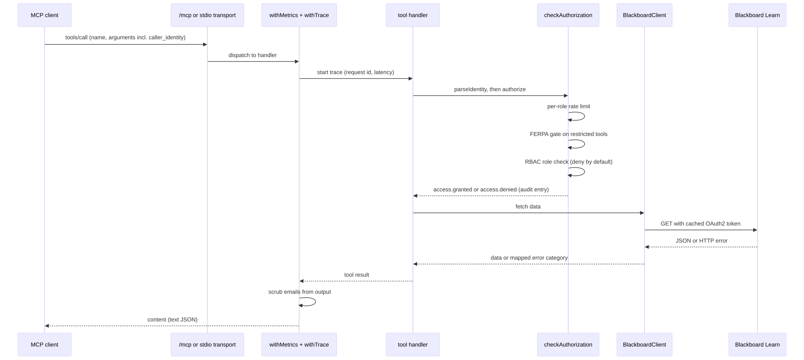
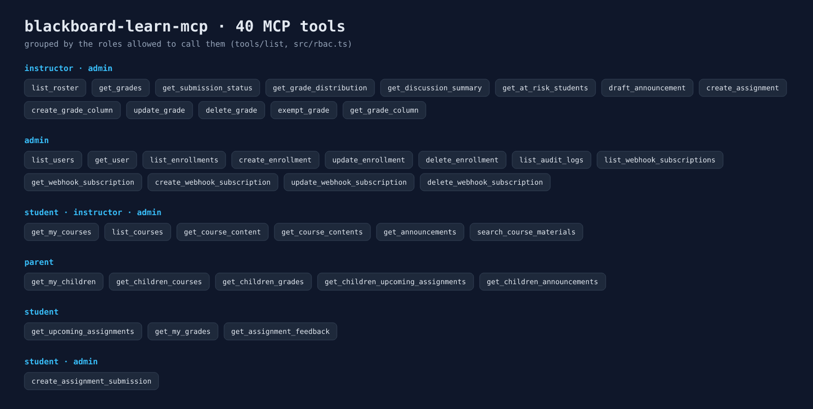
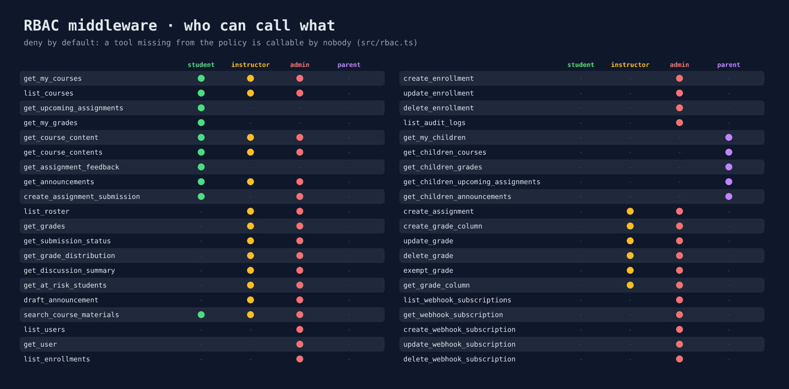
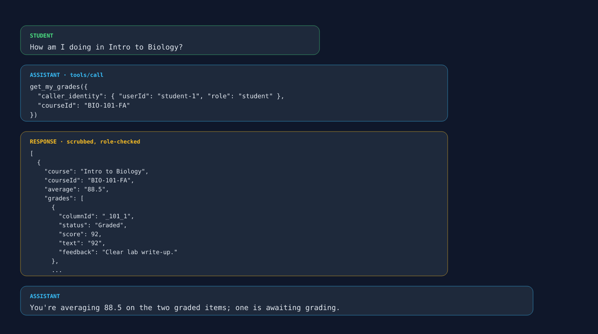

# blackboard-learn-mcp

> 🧭 **bb-mcp** · [Features](./docs/FEATURES.md) · [Roadmap](./docs/ROADMAP.md) · [Tasks](./docs/TASKS.md) · [Changelog](./docs/CHANGELOG.md) · [Metrics](./docs/METRICS.md) <!-- nav -->

<!-- Deployment Status -->
[](https://github.com/nitsuah/bb-mcp/actions/workflows/ci.yml)
[](./docs/METRICS.md)
[-yellow)](./docs/METRICS.md)
[](./docs/METRICS.md)

A standalone [Model Context Protocol](https://modelcontextprotocol.io) server wrapping the Blackboard Learn REST API. Point any MCP-compatible client at it — Claude Desktop, Cursor, agent-board, or anything else — and get structured access to courses, grades, assignments, announcements, and more.

---

## Why standalone?

The integration logic lives here, not in the client. Tools like agent-board, Claude Desktop, and Cursor all connect the same way. Build it once, use it everywhere. Blackboard's own team could point internal tooling at this server without touching any frontend code.

---

## Architecture

```
┌─────────────────────────────────────────────────┐
│   Any MCP Client                                 │
│   (Claude Desktop · Cursor · agent-board · ...)  │
└──────────────────────┬──────────────────────────┘
                       │ MCP Protocol (HTTP or stdio)
                       ▼
┌─────────────────────────────────────────────────┐
│   blackboard-learn-mcp  (this repo)              │
│                                                  │
│   Auth layer       → OAuth2, role gate, FERPA,   │
│                      rate limiting, PII scrub     │
│   Tools (40)       → student, instructor, admin, │
│                      parent, grade write-back,   │
│                      webhook-subscription tools  │
│   Metrics          → Prometheus /metrics         │
│   Audit log        → structured JSON → stdout    │
└──────────────────────┬──────────────────────────┘
                       │ REST API
                       ▼
              Blackboard Learn
          (your instance or sandbox)
```

### Diagrams and generated visuals

bb-mcp has no web UI, so these are generated from the real tool manifest, RBAC policy and `docs/diagrams/*.mmd` by the [visual-docs workflow](./.github/workflows/visual-docs.yml).

<!-- diagrams:start -->



<!-- diagrams:end -->

<!-- screenshots:start -->





<!-- screenshots:end -->

---

## Quick start

```bash
cp .env.example .env   # Fill in BB_CLIENT_ID, BB_CLIENT_SECRET, BB_BASE_URL
docker compose -f config/docker-compose.yml up -d
```

## Development

All checks run via Docker — no local Node.js required.

```bash
# Run all tests (151 tests, TypeScript)
docker compose -f config/docker-compose.yml --profile test run --rm test

# Full quality gate: lint + coverage + audit + complexity
make docker-test

# Individual targets
make docker-lint    # lint only
make docker-build   # production image
```

**Pre-commit hooks** (type-check on commit, tests on push):
```bash
pip install pre-commit && pre-commit install && pre-commit install --hook-type pre-push
```

See `.github/workflows/ci.yml` for the full CI pipeline.

**Journeys** (nightly, no AI): `tests/journeys/` drives the real server over HTTP (health, manifest, the 401 gate, an MCP session, an RBAC refusal) and checks the Pages site at 1440 px and 375 px. Run them in the Playwright image with `docker run --rm -v "$PWD:/w" -w /w -e CI=true mcr.microsoft.com/playwright:v1.64.1-jammy sh -c "npm ci && npm run test:journeys"`. Failures become `bot:journey` issues; the generated `BUGS.md` lives on the [`bot/journeys` branch](https://github.com/nitsuah/bb-mcp/blob/bot/journeys/BUGS.md) ([contract](https://github.com/nitsuah/.github/blob/main/journeys/STANDARD.md)).
## Makefile reference

```sh
make docker-up        # Build and start the standalone bb-mcp container
make docker-logs      # Follow container logs
make docker-doctor    # Safe env readiness report from inside the container
make docker-probe     # Validate Blackboard credentials + minimal API call
make docker-manifest  # Print the provider manifest from the built image
make docker-tools     # Print the published tool catalog from the built image
make docker-down      # Stop the standalone stack
```

### Docker (recommended)

```bash
cp .env.example .env
# Fill in BB_CLIENT_ID, BB_CLIENT_SECRET, BB_BASE_URL
docker compose -f config/docker-compose.yml up -d
```

Repo-local standalone commands:

```bash
make docker-up        # Build and start the standalone bb-mcp container
make docker-logs      # Follow container logs
make docker-doctor    # Safe env readiness report from inside the container
make docker-probe     # Validate Blackboard credentials + minimal API call
make docker-manifest  # Print the provider manifest from the built image
make docker-tools     # Print the published tool catalog from the built image
make docker-down      # Stop the standalone stack
```

The standalone compose stack keeps the same Dockerfile path used by agent-board, but now adds a more confined runtime posture: read-only filesystem, dropped Linux capabilities, `no-new-privileges`, and a small `/tmp` tmpfs for Node runtime needs.

Server is live at `http://localhost:3100`.

| Endpoint | Description |
|---|---|
| `POST /mcp` | MCP protocol entry point |
| `GET /health` | Liveness probe |
| `GET /metrics` | Prometheus text format |
| `GET /manifest` | Provider contract with capabilities and tool manifest |
| `GET /oauth/authorize` | Start the OAuth Authorization Code flow |
| `GET /oauth/callback` | Complete OAuth code exchange and return a managed session |
| `GET /sse/search-course-materials` | Dedicated SSE stream for incremental `search_course_materials` output |

```bash
cp .env.example .env
npm install
npm run dev        # tsx watch — hot reload
```

### stdio mode (Claude Desktop / Cursor)

```bash
npm run build
node dist/index.js --stdio
```

### CLI inspection commands

```bash
# Show available runtime modes and inspection commands
node dist/index.js --help

# Print the provider manifest without starting the server
node dist/index.js --manifest

# List the published tools with role coverage
node dist/index.js --tools

# Emit a safe environment readiness report (no secrets printed)
node dist/index.js --doctor

# Validate Blackboard credentials and a minimal API call
node dist/index.js --probe
```

### Validating with MCP Inspector

```bash
npm run inspect
# or, via Docker (matches CI's build):
make docker-inspect
```

Both run the official [MCP Inspector](https://github.com/modelcontextprotocol/inspector) CLI's `tools/list` method over a real stdio handshake against `node dist/index.js --stdio`, using `config/mcp-inspector.config.example.json` (checked-in, placeholder credentials — Inspector spawns the server with a **sanitized environment that does not inherit your shell or `.env`**, so `BB_CLIENT_ID`/`BB_CLIENT_SECRET` must come from the config file's `env` block or repeated `-e KEY=value` flags; any non-empty values work here since this only validates the transport/protocol/schema layer, not a live Blackboard connection — see `--probe` above for that). Currently passes with **0 errors** (40 schema-portability warnings, all `caller_identity: {}` accepting any value — tracked separately in `TASKS.md` under "Add JSON schemas for all shipped tool inputs").

Claude Desktop config (`claude_desktop_config.json`):

```json
{
  "mcpServers": {
    "blackboard-learn": {
      "command": "node",
      "args": ["/path/to/bb-mcp/dist/index.js", "--stdio"]
    }
  }
}
```

---

## Configuration

Copy `.env.example` to `.env` and set:

| Variable | Required | Description |
|---|---|---|
| `BB_CLIENT_ID` | ✅ | OAuth2 app client ID from [developer.blackboard.com](https://developer.blackboard.com) |
| `BB_CLIENT_SECRET` | ✅ | OAuth2 app client secret |
| `BB_BASE_URL` | ✅ | Base URL of your Blackboard Learn instance |
| `BB_OAUTH_REDIRECT_URI` | — | Override the OAuth callback URL (defaults to `PUBLIC_BASE_URL + /oauth/callback`) |
| `BB_OAUTH_SCOPE` | — | Optional scope string for the authorization code flow |
| `BB_OAUTH_AUTHORIZATION_PATH` | — | Override Blackboard authorization endpoint path |
| `BB_OAUTH_TOKEN_PATH` | — | Override Blackboard token endpoint path |
| `PORT` | — | HTTP port (default `3100`) |
| `HOST` | — | Bind address (default `0.0.0.0`, all interfaces — unchanged from before `MCP_API_KEY` existed, so `docker compose`'s `-p 3100:3100` port publishing keeps working). Set to `127.0.0.1` for a genuinely local-only deployment; see `MCP_API_KEY` below. |
| `LOG_LEVEL` | — | `info` or `debug` (default `info`) |
| `PUBLIC_BASE_URL` | — | Publicly reachable base URL of this server (e.g. `https://mcp.example.com`); used in manifest generation and as the OAuth redirect base; defaults to `http://localhost:<PORT>` |
| `MCP_API_KEY` | Optional second factor | If set with OIDC, send it as `X-MCP-API-Key`; `Authorization: Bearer` carries the end-user OIDC access token. Non-loopback deployments require OIDC regardless of this key. |
| `TLS_CERT_PATH`, `TLS_KEY_PATH` | — | Paths to a PEM cert chain and matching private key. Set both to serve HTTPS directly instead of plain HTTP. |
| `TRUST_PROXY_TLS` | Alternative to `TLS_CERT_PATH`/`TLS_KEY_PATH` | Set to `true` when a trusted TLS-terminating reverse proxy (nginx, Traefik, Caddy, etc.) shares this process's network namespace. **This overrides `HOST` and forces the server to actually bind to loopback** rather than merely asserting a proxy exists — a configured `HOST` would otherwise remain a second, unprotected path straight to this plain-HTTP listener. Only a proxy in the same namespace (same container, Docker's `network_mode: service:<name>`, a Kubernetes sidecar, etc.) can then reach it; nothing routes to it from outside that boundary. Without this or `TLS_CERT_PATH`/`TLS_KEY_PATH`, the server refuses to start on a non-loopback `HOST`. |
| `OIDC_ISSUER`, `OIDC_AUDIENCE`, `OIDC_JWKS_URI` | Required for non-loopback deployments | Validate signed RS256 bearer access tokens against the configured issuer, API audience, and JWKS endpoint. Set all three together; provider-specific SDKs are not required. |
| `OIDC_USER_ID_CLAIM` | — | Claim path for stable end-user ID (default `sub`). |
| `OIDC_ROLE_CLAIM` | — | Claim path containing the role or group values (default `role`). |
| `OIDC_ROLE_MAP` | — | Comma-separated provider-claim-to-bb-mcp-role mapping. A token must resolve to exactly one role. |
| `OIDC_FERPA_CLAIM` | — | Signed claim that must be boolean `true` to satisfy FERPA authorization (default `ferpa_authorized`). |
| `OIDC_MTLS_MODE` | — | `disabled`, `optional`, `required`, or `trusted-proxy`. Direct mTLS modes require HTTPS plus `MTLS_CA_PATH` pointing to the trusted client-certificate CA bundle; proxy mode requires `TRUST_PROXY_TLS=true` and a trusted proxy that rewrites `X-Client-Cert-Verified`. |
| `METRICS_PUSH_URL` | — | Prometheus push gateway URL (optional) |
| `RESTRICTED_TOOLS` | — | Comma-separated tool names requiring FERPA auth (default: `get_at_risk_students,get_grade_distribution,get_submission_status,get_grades,list_users,get_user,list_enrollments,list_audit_logs`) |
| `RATE_LIMIT_STUDENT_PER_MINUTE` | — | Max tool calls per minute for student role (default `60`) |
| `RATE_LIMIT_INSTRUCTOR_PER_MINUTE` | — | Max tool calls per minute for instructor role (default `120`) |
| `RATE_LIMIT_ADMIN_PER_MINUTE` | — | Max tool calls per minute for admin role (default `180`) |
| `RATE_LIMIT_PARENT_PER_MINUTE` | — | Max tool calls per minute for parent role (default `60`) |

**Getting Blackboard credentials:**  
Register a REST API application at [developer.blackboard.com](https://developer.blackboard.com/portal/applications). Use the free developer sandbox for testing — no live Blackboard instance required.

### Authorization Code flow

bb-mcp now supports an operator-driven OAuth Authorization Code flow in addition to the existing client credentials probe path.

1. Visit `GET /oauth/authorize` to start the flow.
2. Blackboard redirects back to `GET /oauth/callback`.
3. bb-mcp validates the `state`, performs PKCE-backed token exchange, and returns a managed session payload.

For non-browser operators, `GET /oauth/authorize?format=json` returns the authorization URL and redirect URI without issuing an HTTP redirect.

---

## Tools

Every tool requires a `caller_identity` argument:

```json
{
  "caller_identity": {
    "userId": "bbuser123",
    "role": "student",
    "clientApp": "agent-board"
  }
}
```

For FERPA-restricted tools, add `"ferpa_authorized": true` — the calling application is responsible for asserting this only after real identity verification.

### Student tools

| Tool | Description |
|---|---|
| `get_my_courses` | Courses the caller is enrolled in |
| `list_courses` | Alias for `get_my_courses` — compatibility name |
| `get_upcoming_assignments` | Assignments due within N days, sorted by due date |
| `get_my_grades` | Grade breakdown across all courses or one course |
| `get_course_content` | Course modules and materials, with optional keyword search |
| `get_course_contents` | Alias for `get_course_content` — compatibility name |
| `get_assignment_feedback` | Instructor comments, rubric scores, and annotations |
| `get_announcements` | Course announcements |
| `create_assignment_submission` | Submit an assignment attempt with optional student comments |

### Instructor tools

| Tool | Description | FERPA required |
|---|---|---|
| `list_roster` | Enrolled users for a course, including user IDs and usernames | — |
| `get_grades` | Course-wide or user-scoped grade details, optionally filtered to one column | ✅ |
| `get_submission_status` | Who submitted, who hasn't, timestamps | ✅ |
| `get_grade_distribution` | Mean, median, std dev, A/B/C/D/F buckets | ✅ |
| `get_discussion_summary` | Participant count and post excerpts for a thread | — |
| `get_at_risk_students` | Students with low grades or many missing submissions | ✅ |
| `draft_announcement` | AI-assisted announcement draft, optionally posted | — |

### Grade write-back tools

| Tool | Description | FERPA required |
|---|---|---|
| `create_assignment` | Creates a student-visible content item + linked grade column in one call | — |
| `create_grade_column` | Creates a gradebook column only (no content item) | — |
| `update_grade` | Updates (or creates) a student's grade attempt for a column | — |
| `delete_grade` | Deletes a student's grade attempt for a column | — |
| `exempt_grade` | Marks a student's grade as exempt for a column | — |
| `get_grade_column` | Returns details of a specific grade column | — |

All require instructor or admin role.

### Admin tools

| Tool | Description | FERPA required |
|---|---|---|
| `list_users` | Paginated user directory with optional search | ✅ |
| `get_user` | Single user record by ID | ✅ |
| `list_enrollments` | Enrollments filtered by course, user, or both | ✅ |
| `create_enrollment` | Enrolls a user in a course | — |
| `update_enrollment` | Updates an enrollment's role/availability | — |
| `delete_enrollment` | Removes an enrollment | — |
| `list_audit_logs` | Institutional audit logs — Blackboard's own (when available) plus bb-mcp's local access-audit trail | ✅ |

All require admin role.

### Parent tools (guardian-scoped, read-only)

| Tool | Description |
|---|---|
| `get_my_children` | Students the caller is a registered guardian/observer for |
| `get_children_courses` | Course enrollments for one or all children |
| `get_children_grades` | Grade summaries for one or all children |
| `get_children_upcoming_assignments` | Upcoming assignments across children |
| `get_children_announcements` | Course announcements relevant to children |

All require parent role.

### Webhook subscription tools

| Tool | Description |
|---|---|
| `list_webhook_subscriptions` | Lists registered Blackboard webhook subscriptions |
| `get_webhook_subscription` | Returns a single webhook subscription |
| `create_webhook_subscription` | Registers a new webhook subscription |
| `update_webhook_subscription` | Updates an existing subscription |
| `delete_webhook_subscription` | Removes a subscription |

All require admin role. This is subscription *registration* only — receiving inbound webhook calls and bridging them to the MCP SSE transport is tracked in `ROADMAP.md`'s 2027 section.

### Shared tools

| Tool | Description |
|---|---|
| `search_course_materials` | Full-text search across content in one or all courses |

### MCP Resources

| URI | Description |
|---|---|
| `course://{courseId}` | Full course object as JSON |

---

## Identity & access control

**Remote end-user authentication (OIDC)** — every non-loopback deployment must configure `OIDC_ISSUER`, `OIDC_AUDIENCE`, and `OIDC_JWKS_URI`. A shared `MCP_API_KEY` authenticates a client application, not the person represented by `caller_identity`. The HTTP boundary verifies the RS256 signature against the configured JWKS, exact issuer, audience, expiration, and time claims, then derives the principal from signed claims. Client-supplied identity values must match the verified principal and cannot elevate role or FERPA authorization. Entra ID, Okta, and other OIDC providers are supported through configuration. The existing Blackboard OAuth authorization-code flow remains separate because it creates Blackboard API sessions, not general-purpose institutional identity tokens.

When OIDC is enabled, send the user's access token as `Authorization: Bearer <OIDC_ACCESS_TOKEN>`. If `MCP_API_KEY` is also configured, send it as `X-MCP-API-Key`. Do not send access tokens over plain HTTP.

**mTLS** — `OIDC_MTLS_MODE=required` requires a trusted client certificate and OIDC. `optional` permits OIDC without a certificate but rejects an explicitly presented untrusted certificate. Both direct modes require `TLS_CERT_PATH` and `TLS_KEY_PATH`. `trusted-proxy` is for mTLS terminated at a trusted gateway/service mesh; it requires `TRUST_PROXY_TLS=true`, which forces a loopback bind, and the proxy must strip/rewrite `X-Client-Cert-Verified` to `SUCCESS` only after certificate verification. The proxy must be the only process able to reach the listener.

Loopback-only deployments can still use the legacy local-client flow without OIDC. It is not permitted on network-reachable binds.

Once authenticated, the authorization layer enforces:
1. **Verified identity** — in OIDC mode, `caller_identity.userId`, `role`, and `ferpa_authorized` cannot override signed claims. Contradictory user/role claims and forged FERPA elevation are rejected.
2. **Rate gate** — per-role, per-minute call limits prevent bulk data extraction; 429 responses include a retry-after interval.
3. **Role gate** — instructor-only tools reject student callers; unknown tools are denied by default.
4. **FERPA gate** — protected student-data tools require a signed, server-verified `ferpa_authorized: true` claim in OIDC mode.
5. **Course entitlement gate** — grade write-back tools verify that the caller is enrolled in the target course as Instructor, TeachingAssistant, or CourseBuilder. The admin role retains its documented org-wide bypass.

Every access attempt (granted or denied) is written to stdout as structured JSON and kept in a bounded in-memory ring buffer. User identifiers in bb-mcp's local audit trail are SHA-256 hashed before emission or storage. The separate Blackboard `/audit/logs` response is passed through as Blackboard provides it.

Every tool response is also scrubbed before it reaches the MCP client — `src/output-scrub.ts` strips email addresses from tool payloads centrally via `withMetrics()`.

Example local audit event:

```json
{
  "timestamp": "2026-03-24T10:00:00.000Z",
  "event": "access.granted",
  "tool": "get_my_grades",
  "subject": "anon:a3f9c1e02b47",
  "role": "student",
  "courseId": null,
  "clientApp": "agent-board",
  "reason": null,
  "piiRedaction": "hashed-subject"
}
```

This format is suitable for ingestion by log aggregators such as Datadog, CloudWatch, and Loki.

## Metrics

`GET /metrics` returns Prometheus-compatible text:

```
bb_mcp_tool_calls_total{tool="get_my_courses"} 42
bb_mcp_tool_errors_total{tool="get_my_grades"} 1
bb_mcp_tool_avg_duration_ms{tool="get_upcoming_assignments"} 238
```

Set `METRICS_PUSH_URL` to push to a Prometheus push gateway every 60 seconds.

---

## agent-board integration

The server runs as a service in agent-board's Docker stack. The connector config lives at `agent-board/config/connectors.json`:

```json
{
  "name": "Blackboard Learn",
  "mcp_server": "http://bb-mcp:3100",
  "system_prompt": "You are a helpful study assistant...",
  "safety_config": "strict",
  "guided_prompts": [
    "What do I have due this week?",
    "How am I doing in my courses?",
    "Summarize what I missed"
  ]
}
```

agent-board proxies MCP calls through `POST /api/mcp/blackboard-learn/proxy`, keeping credentials server-side.

---

## Project structure

```
bb-mcp/
├── src/
│   ├── index.ts          Entry point — HTTP + stdio transports
│   ├── config.ts         Env validation and rate-limit config
│   ├── bb-client.ts      Blackboard REST API client (OAuth2 auto-refresh)
│   ├── auth.ts           Rate limit, role gate, FERPA guard, audit logging
│   ├── rbac.ts           Tool-to-role policy map
│   ├── oauth.ts          PKCE authorization code flow + session store
│   ├── manifest.ts       Provider manifest builder (GET /manifest)
│   ├── metrics.ts        Prometheus metrics + withMetrics() wrapper
│   │                     (also applies output-scrub to every tool result)
│   ├── privacy.ts        PII scrubbing (audit logs) and subject hashing
│   ├── output-scrub.ts   PII scrubbing (tool-call responses to the client)
│   ├── schemas.ts        Shared Zod schemas
│   ├── cli.ts            CLI subcommands (--doctor, --probe, --tools, etc.)
│   ├── constants.ts      SERVER_NAME, SERVER_VERSION
│   ├── types.ts          Domain types (BbCourse, BbGrade, etc.)
│   └── tools/
│       ├── student.ts         Student-facing tools (9 incl. aliases)
│       ├── instructor.ts      Instructor-facing tools (7)
│       ├── grade-writeback.ts Grade write-back + create_assignment (6)
│       ├── admin.ts           Admin directory/enrollment/audit tools (7)
│       ├── parent.ts          Guardian-scoped read-only tools (5)
│       ├── webhook-tools.ts   Webhook subscription CRUD (5)
│       └── shared.ts          search_course_materials (1)
├── config/
│   ├── docker-compose.yml  Standalone stack (port 3100)
│   ├── vitest.config.ts    Test runner config
│   └── eslint.config.mjs   Lint config
├── Dockerfile            Multi-stage build (node:22-slim)
├── .env.example
├── package.json
└── tsconfig.json
```

---

## Sandbox testing

No live Blackboard instance needed. Register a free developer account at [developer.blackboard.com](https://developer.blackboard.com), create a REST API application, and use the provided sandbox URL as `BB_BASE_URL`. The sandbox exposes the full API surface with pre-populated test data.

---

<!-- docs-index:start -->

## Docs Index

Every doc at the repo root (other than this README) and under `docs/` (the files mirrored into the Obsidian vault), so none of them is orphaned.

- [Changelog](./docs/CHANGELOG.md) — `docs/CHANGELOG.md`
- [Features](./docs/FEATURES.md) — `docs/FEATURES.md`
- [Metrics](./docs/METRICS.md) — `docs/METRICS.md`
- [ROADMAP](./docs/ROADMAP.md) — `docs/ROADMAP.md`
- [TASKS](./docs/TASKS.md) — `docs/TASKS.md`

**`docs/archive/`**

- [Delivery Pipeline Handoff](./docs/archive/HANDOFF-mcp-provider-contract-20260403.md) — `docs/archive/HANDOFF-mcp-provider-contract-20260403.md`
- [Archived docs](./docs/archive/README.md) — `docs/archive/README.md`
- [Blackboard Learn — MCP Server & Agent-Board Integration](./docs/archive/blackboard-learn-mcp-plan.md) — `docs/archive/blackboard-learn-mcp-plan.md`
- [Project: blackboard-learn-mcp + agent-board Edtech Integration](./docs/archive/blackboard-mcp-full-plan.md) — `docs/archive/blackboard-mcp-full-plan.md`

<!-- docs-index:end -->

## License

MIT

## Community Standards

Shared community policies are centralized in https://github.com/nitsuah/.github:
- Contributing: https://github.com/nitsuah/.github/blob/main/CONTRIBUTING.md
- Code of Conduct: https://github.com/nitsuah/.github/blob/main/CODE_OF_CONDUCT.md
- Security: https://github.com/nitsuah/.github/blob/main/SECURITY.md
